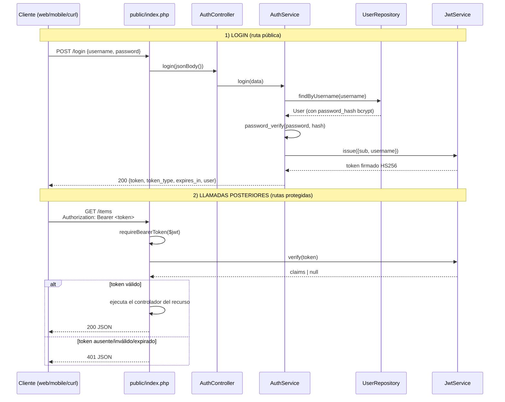

# Flujo de autenticación y uso del JWT

Documento didáctico del proyecto `progra4-api`: describe **paso a paso** cómo se
emite un JWT al iniciar sesión y cómo ese token se usa en las llamadas
posteriores. Cada paso incluye el fragmento de código real que lo implementa y
la ruta del archivo donde vive.

La API es PHP puro (sin framework) y el JWT se implementa a mano con firma
**HS256** en `src/Security/JwtService.php`.

---

## Resumen del flujo



Las rutas se dividen en dos grupos (ver `public/index.php:320-366`):

| Tipo | Rutas | ¿Requiere JWT? |
|---|---|---|
| Públicas | `POST /login`, `POST /register` | No |
| Protegidas | `/items`, `/categorias`, `/pedidos` | Sí (`Authorization: Bearer <jwt>`) |

---

## Paso 1. Configurar el secreto y la vigencia del token

**Dónde:** `.env` / `.env.example` y `public/index.php`.

El secreto con el que se firma el token no va en el código: se lee de la
variable de entorno `JWT_SECRET`. La vigencia se controla con
`JWT_TTL_SECONDS`.

`.env.example:16-22`:

```dotenv
# Secreto de firma HS256 de los tokens JWT. Debe coincidir con el JWT_SECRET
# del server progra4-notifications. Valor de desarrollo: cambiar en cualquier
# entorno real.
JWT_SECRET=secreto-solo-para-desarrollo-cambiar

# Vigencia del token en segundos.
JWT_TTL_SECONDS=3600
```

`src/bootstrap.php:78` carga ese archivo al entorno (sin pisar variables ya
definidas en la terminal):

```php
loadDotEnv(dirname(__DIR__) . '/.env');
```

Luego, en el *composition root* del front controller se construye el servicio
con esos valores (`public/index.php:211-214`):

```php
$jwt = new JwtService(
    getenv('JWT_SECRET') ?: 'secreto-solo-para-desarrollo-cambiar',
    (int) (getenv('JWT_TTL_SECONDS') ?: 3600),
);
```

> El valor por defecto es **solo para desarrollo**. En un entorno real hay que
> definir un secreto propio y no versionarlo.

---

## Paso 2. Registrar usuarios con contraseña hasheada

**Dónde:** `src/Services/AuthService.php` y `src/Repositories/SqliteUserRepository.php`.

Antes de poder loguearse, el usuario debe existir. La contraseña nunca se guarda
en texto plano: se hashea con **bcrypt** (`password_hash`).

`src/Services/AuthService.php:35-72` (registro):

```php
public function register(array $data): array
{
    $errors = [];
    // ... validaciones de username y password ...

    if ($this->users->findByUsername($username) !== null) {
        throw new ValidationException(['username' => ['El usuario ya está registrado.']]);
    }

    $id = $this->users->save($username, password_hash($data['password'], PASSWORD_BCRYPT));

    return [
        'token'      => $this->jwt->issue([
            'sub'      => $id,
            'username' => $username,
        ]),
        'token_type' => 'Bearer',
        'expires_in' => $this->jwt->ttlSeconds(),
        'user'       => ['id' => $id, 'username' => $username],
    ];
}
```

El repositorio solo ve el **hash**, nunca la contraseña (`src/Repositories/SqliteUserRepository.php:21-57`):

```php
private const SCHEMA_SQL = <<<'SQL'
    CREATE TABLE IF NOT EXISTS users (
        id            INTEGER PRIMARY KEY AUTOINCREMENT,
        username      TEXT NOT NULL UNIQUE,
        password_hash TEXT NOT NULL
    )
    SQL;

public function findByUsername(string $username): ?User
{
    $stmt = $this->pdo->prepare('SELECT id, username, password_hash FROM users WHERE username = :username');
    $stmt->execute([':username' => $username]);

    $row = $stmt->fetch();
    return $row === false ? null : new User((int) $row['id'], (string) $row['username'], (string) $row['password_hash']);
}

public function save(string $username, string $passwordHash): int
{
    $stmt = $this->pdo->prepare('INSERT INTO users (username, password_hash) VALUES (:username, :password_hash)');
    $stmt->execute([':username' => $username, ':password_hash' => $passwordHash]);
    return (int) $this->pdo->lastInsertId();
}
```

Al primer arranque se siembra un usuario de demostración (`SqliteUserRepository.php:59-71`):

```php
$insert->execute([
    ':username'      => 'admin',
    ':password_hash' => password_hash('qwerty67', PASSWORD_BCRYPT),
]);
```

Credenciales sembradas: **`admin` / `qwerty67`**.

---

## Paso 3. `POST /login`: ruta pública

**Dónde:** `public/index.php`.

El front controller enruta `POST /login` al controlador **sin exigir token**.
Es el único punto de entrada del flujo de autenticación (`public/index.php:320-324`):

```php
// Rutas PÚBLICAS: login y registro.
if ($resource === 'login' && $method === 'POST' && $id === null) {
    $response = $authController->login(jsonBody());
} elseif ($resource === 'register' && $method === 'POST' && $id === null) {
    $response = $authController->register(jsonBody());
}
```

El cuerpo JSON se decodifica con `jsonBody()` (`public/index.php:141-152`), que
lanza `422` si el body no es un objeto JSON válido.

---

## Paso 4. El controlador delega en el servicio

**Dónde:** `src/Controllers/AuthController.php`.

El controlador es una capa fina: traduce HTTP ↔ servicio, sin conocer
repositorios ni JWT (`src/Controllers/AuthController.php:20-30`):

```php
/** POST /register -> 201 con JWT | 422 validación | 422 usuario duplicado. */
public function register(array $body): JsonResponse
{
    return new JsonResponse(201, $this->authService->register($body));
}

/** POST /login -> 200 con JWT | 401 credenciales inválidas | 422 campos faltantes. */
public function login(array $body): JsonResponse
{
    return new JsonResponse(200, $this->authService->login($body));
}
```

La inyección de dependencias se hace una sola vez en el front controller
(`public/index.php:216`):

```php
$authController = new AuthController(new AuthService($userRepository, $jwt));
```

---

## Paso 5. Validar credenciales y comparar el hash

**Dónde:** `src/Services/AuthService.php`.

`login()` hace tres cosas: valida los campos (422), busca el usuario y compara
la contraseña recibida contra el hash guardado con `password_verify()`
(`src/Services/AuthService.php:78-111`):

```php
public function login(array $data): array
{
    $errors = [];

    $username = isset($data['username']) && is_string($data['username']) ? trim($data['username']) : '';
    if ($username === '') {
        $errors['username'][] = 'El usuario es obligatorio.';
    }

    if (!isset($data['password']) || !is_string($data['password']) || $data['password'] === '') {
        $errors['password'][] = 'La contraseña es obligatoria.';
    }

    if ($errors !== []) {
        throw new ValidationException($errors);
    }

    $user = $this->users->findByUsername($username);

    // Mensaje genérico a propósito: no se revela si falló el usuario o la clave.
    if ($user === null || !password_verify($data['password'], $user->getPasswordHash())) {
        throw new UnauthorizedException('Credenciales inválidas.');
    }

    return [
        'token'      => $this->jwt->issue([
            'sub'      => $user->getId(),
            'username' => $user->getUsername(),
        ]),
        'token_type' => 'Bearer',
        'expires_in' => $this->jwt->ttlSeconds(),
        'user'       => $user->toArray(),
    ];
}
```

Puntos clave:

- Si faltan campos → `ValidationException` → **422** con detalle por campo.
- Si el usuario no existe o la clave no coincide → `UnauthorizedException` → **401**.
- El mensaje de error es genérico: no revela qué credencial falló.
- El `User::toArray()` usado en la respuesta **no incluye** `password_hash`
  (`src/Models/User.php:37-44`).

---

## Paso 6. Emitir y firmar el JWT

**Dónde:** `src/Security/JwtService.php`.

Al autenticar correctamente, el servicio pide un token con los claims de
negocio `sub` (id del usuario) y `username`. `issue()` agrega `iss`, `iat` y
`exp`, y arma el token (`src/Security/JwtService.php:46-61`):

```php
public function issue(array $claims): string
{
    $now = time();
    $payload = array_merge([
        'iss' => $this->issuer,
        'iat' => $now,
        'exp' => $now + $this->ttlSeconds,
    ], $claims);

    $header = $this->base64UrlEncode(
        (string) json_encode(['alg' => self::ALG, 'typ' => 'JWT'], JSON_UNESCAPED_UNICODE)
    );
    $body = $this->base64UrlEncode((string) json_encode($payload, JSON_UNESCAPED_UNICODE));

    return $header . '.' . $body . '.' . $this->signature($header . '.' . $body);
}
```

La firma es un HMAC-SHA256 con el secreto compartido (`JwtService.php:109-119`):

```php
/** HMAC-SHA256 codificado en base64url: la firma del token. */
private function signature(string $data): string
{
    return $this->base64UrlEncode(hash_hmac('sha256', $data, $this->secret, true));
}

/** Base64 variante URL-safe (sin +, / ni =), tal como exige el estándar JWT. */
private function base64UrlEncode(string $bytes): string
{
    return rtrim(strtr(base64_encode($bytes), '+/', '-_'), '=');
}
```

Estructura del token:

```
base64url(header) . "." . base64url(payload) . "." . firma
```

Ejemplo de payload (visible, **no cifrado**):

```json
{
  "iss": "api-items",
  "iat": 1760000000,
  "exp": 1760003600,
  "sub": 1,
  "username": "admin"
}
```

> El payload solo está codificado en base64url, no cifrado: cualquiera puede
> leerlo. **Nunca** poner datos sensibles ahí; la seguridad la aporta la firma.

---

## Paso 7. Devolver el token al cliente

La respuesta de `POST /login` es `200` con este cuerpo:

```json
{
    "token": "eyJhbGciOiJIUzI1NiIsInR5cCI6IkpXVCJ9...",
    "token_type": "Bearer",
    "expires_in": 3600,
    "user": { "id": 1, "username": "admin" }
}
```

El cliente debe guardar `token` y enviarlo en cada llamada protegida dentro del
encabezado:

```
Authorization: Bearer <token>
```

---

## Paso 8. Lado cliente: guardar y adjuntar el JWT

**Dónde (referencia):** `progra4-web/src/services/api.js` y
`progra4-web/src/stores/authStore.js`.

Esta parte no vive en la API, pero muestra cómo se consume. El login guarda el
token (`progra4-web/src/stores/authStore.js:26-32`):

```js
export async function login(payload) {
  const data = await api.login(payload)
  storage.setToken(data.token)
  storage.setUser(data.user)
  setState({ user: data.user, token: data.token })
  return data.user
}
```

Y cada petición lo adjunta como Bearer (`progra4-web/src/services/api.js:83-89`):

```js
async function request(path, { method = 'GET', body, auth = true } = {}) {
  const headers = {}
  if (body !== undefined) headers['Content-Type'] = 'application/json'
  if (auth) {
    const token = storage.getToken()
    if (token) headers['Authorization'] = `Bearer ${token}`
  }
  // ... fetch(`${API_BASE}${path}`, { method, headers, body }) ...
}
```

`/login` y `/register` se llaman con `auth: false`; el resto usa el token por
defecto (`api.js:119-128`).

---

## Paso 9. Middleware de autorización: extraer el Bearer

**Dónde:** `public/index.php`.

Cada rama de recurso protegido llama primero a `requireBearerToken()` antes de
llegar al controlador (`public/index.php:154-175`):

```php
/**
 * "Middleware" de AUTORIZACIÓN: valida el encabezado
 *   Authorization: Bearer <jwt>
 * Devuelve los claims del token o lanza 401 si falta, está alterado o expiró.
 */
function requireBearerToken(JwtService $jwt): array
{
    $header = trim($_SERVER['HTTP_AUTHORIZATION'] ?? '');

    if (!preg_match('/^Bearer\s+(\S+)$/i', $header, $m)) {
        throw new UnauthorizedException('Falta el encabezado Authorization: Bearer <token>.');
    }

    $claims = $jwt->verify($m[1]);
    if ($claims === null) {
        throw new UnauthorizedException('Token inválido o expirado.');
    }

    return $claims;
}
```

Para que un navegador pueda enviar ese encabezado, el CORS debe permitirlo
(`public/index.php:99`):

```php
header('Access-Control-Allow-Headers: Content-Type, Authorization');
```

---

## Paso 10. Verificar firma, algoritmo y expiración

**Dónde:** `src/Security/JwtService.php`.

`verify()` es el corazón de la autorización (`JwtService.php:68-107`):

```php
public function verify(string $token): ?array
{
    $parts = explode('.', $token);
    if (count($parts) !== 3) {
        return null;
    }
    [$header, $body, $signature] = $parts;

    // 1) Firma: comparación en tiempo constante para evitar timing attacks.
    if (!hash_equals($signature, $this->signature($header . '.' . $body))) {
        return null;
    }

    // 2) Header: el algoritmo declarado debe ser el que nosotros usamos.
    $rawHeader = $this->base64UrlDecode($header);
    if ($rawHeader === false) {
        return null;
    }
    $headerData = json_decode($rawHeader, true);
    if (!is_array($headerData) || ($headerData['alg'] ?? '') !== self::ALG) {
        return null;
    }

    // 3) Payload decodificable...
    $rawBody = $this->base64UrlDecode($body);
    if ($rawBody === false) {
        return null;
    }
    $claims = json_decode($rawBody, true);
    if (!is_array($claims)) {
        return null;
    }

    // 4) ...y vigente (exp en segundos Unix).
    if (!isset($claims['exp']) || !is_int($claims['exp']) || $claims['exp'] < time()) {
        return null;
    }

    return $claims;
}
```

Qué se comprueba, en orden:

1. **Formato**: exactamente tres segmentos separados por `.`.
2. **Firma**: `hash_equals` (tiempo constante) contra el HMAC recalculado.
   Cualquier alteración del header o del payload invalida el token.
3. **Algoritmo**: el `alg` del header debe ser exactamente `HS256`; evita el
   ataque de cambiar el algoritmo declarado.
4. **Vigencia**: `exp` debe existir, ser entero y no haber pasado.
5. Si todo pasa, devuelve los **claims**; si algo falla, `null` → 401.

---

## Paso 11. Usar el JWT en las rutas protegidas

**Dónde:** `public/index.php`.

### `/items` y `/categorias`

Se valida el token y se descartan los claims porque esos controladores no los
necesitan (`public/index.php:325-343`):

```php
} elseif ($resource === 'categorias') {
    // Rutas PROTEGIDAS: se corta aquí si el JWT no es válido (401),
    $claims = requireBearerToken($jwt);
    unset($claims);

    $response = match (true) {
        $method === 'GET'    && $id === null && $sub === null => $categoriaController->index(),
        // ...
    };
} elseif ($resource === 'items') {
    // Rutas PROTEGIDAS: se corta aquí si el JWT no es válido (401),
    // antes de llegar al controlador. Los claims quedan disponibles.
    $claims = requireBearerToken($jwt);
    unset($claims); // el controlador actual no los necesita; podrían inyectarse

    $response = match (true) {
        $method === 'GET'    && $id === null => $itemController->index($page, $perPage, $categoriaId, $search),
        $method === 'POST'   && $id === null => $itemController->store(jsonBody()),
        $method === 'GET'    && $id !== null => $itemController->show($id),
        $method === 'PUT'    && $id !== null => $itemController->update($id, jsonBody()),
        $method === 'DELETE' && $id !== null => $itemController->destroy($id),
        // ...
    };
}
```

### `/pedidos`: el claim `username` se usa como identidad

Este es el caso donde el token no solo autoriza: también aporta el dato de quién
hace la operación. El `username` sale de los claims, **nunca** del cuerpo de la
petición (`public/index.php:353-362`):

```php
} elseif ($resource === 'pedidos') {
    // Rutas PROTEGIDAS: se corta aquí si el JWT no es válido (401).
    // El username se toma de los claims del token y se inyecta al servicio.
    $claims = requireBearerToken($jwt);
    $username = (string) ($claims['username'] ?? '');

    $response = match (true) {
        $method === 'GET'  && $id === null => $pedidoController->index(),
        $method === 'POST' && $id === null => $pedidoController->store($username, jsonBody()),
        // ...
    };
}
```

> Esto evita que un cliente falsee el autor del pedido enviando otro `username`
> en el JSON: la identidad la fija el token firmado.

---

## Paso 12. Respuestas de error del flujo

**Dónde:** `public/index.php` y `src/Exceptions/`.

Las excepciones de negocio se traducen a códigos HTTP con JSON uniforme
(`public/index.php:367-377`):

```php
} catch (ApiException $e) {
    // Excepciones de negocio -> códigos HTTP previstos (401, 404, 422).
    if ($e->httpStatus() === 401) {
        header('WWW-Authenticate: Bearer realm="api-items"');
    }

    $payload = ['error' => $e->getMessage()];
    if ($e instanceof ValidationException) {
        $payload['errors'] = $e->getErrors();
    }
    $response = new JsonResponse($e->httpStatus(), $payload);
}
```

`UnauthorizedException` siempre responde **401** (`src/Exceptions/UnauthorizedException.php:12-22`):

```php
final class UnauthorizedException extends ApiException
{
    public function __construct(string $message = 'No autorizado.')
    {
        parent::__construct($message);
    }

    public function httpStatus(): int
    {
        return 401;
    }
}
```

Casos posibles:

| Situación | Status | Cuerpo |
|---|---|---|
| Faltan `username`/`password` | 422 | `{"error": "...", "errors": {...}}` |
| Credenciales incorrectas | 401 | `{"error": "Credenciales inválidas."}` |
| Falta `Authorization` o mal formado | 401 | `{"error": "Falta el encabezado Authorization: Bearer <token>."}` |
| Firma alterada, `alg` distinto o token expirado | 401 | `{"error": "Token inválido o expirado."}` |
| Token válido pero recurso inexistente | 404 | `{"error": "..."}` |

En todos los `401` se agrega el encabezado `WWW-Authenticate: Bearer realm="api-items"`.

---

## Paso 13. Prueba completa (end-to-end)

Con la API levantada (`php -S localhost:8000 -t public`):

```powershell
# 1) Login: obtener el JWT
$resp = curl.exe -s -X POST -H "Content-Type: application/json" `
     -d '{"username":"admin","password":"qwerty67"}' `
     http://localhost:8000/login
$token = ($resp | ConvertFrom-Json).token

# 2) Usar el JWT en una ruta protegida
curl.exe -s -H "Authorization: Bearer $token" http://localhost:8000/items

# 3) Crear un item con el JWT
curl.exe -s -X POST -H "Authorization: Bearer $token" -H "Content-Type: application/json" `
     -d '{"nombre":"Lampara LED","precio":12.5}' `
     http://localhost:8000/items

# 4) Comprobar el 401 sin token
curl.exe -s -i http://localhost:8000/items
```

---

## Paso 14. Expiración y buenas prácticas

- **Vigencia**: el token expira a los `JWT_TTL_SECONDS` (default 3600 s). Para
  probarlo: `$env:JWT_TTL_SECONDS='1'`, loguearse, esperar 2 s y llamar a
  `/items` → `401 Token inválido o expirado.`
- **Secreto compartido**: `JWT_SECRET` debe ser el mismo en `progra4-api` y en
  `progra4-notifications`, que valida los mismos tokens para el WebSocket.
- **HTTPS**: el token viaja en cada request; sin TLS puede ser interceptado.
  Ver `https-proxy.php` / `serve-https.cmd`.
- **CORS**: solo se reflejan orígenes de la lista blanca y se permite el header
  `Authorization`; nunca `Access-Control-Allow-Origin: *` (ver `public/index.php:69-100`).
- **Sin datos sensibles en el payload**: el JWT está firmado, no cifrado.
- **Producción**: `JwtService` es didáctico (implementado a mano). En un sistema
  real conviene una librería mantenida (`firebase/php-jwt`) y añadir refresh
  tokens y revocación.

---

## Mapa rápido de archivos

| Paso | Archivo | Responsabilidad |
|---|---|---|
| Configuración del secreto | `.env` / `src/bootstrap.php` / `public/index.php` | Leer `JWT_SECRET` y `JWT_TTL_SECONDS` |
| Alta de usuario | `src/Services/AuthService.php`, `src/Repositories/SqliteUserRepository.php` | Validar y guardar `password_hash` bcrypt |
| Ruta pública `POST /login` | `public/index.php` | Enrutar sin exigir token |
| Delegación HTTP | `src/Controllers/AuthController.php` | Traducir HTTP ↔ servicio |
| Verificación de credenciales | `src/Services/AuthService.php` | `password_verify` y 401 genérico |
| Emisión del JWT | `src/Security/JwtService.php` | `issue()`: claims + HMAC-SHA256 |
| Extracción del Bearer | `public/index.php` (`requireBearerToken`) | Parsear `Authorization: Bearer` |
| Verificación del JWT | `src/Security/JwtService.php` | `verify()`: firma, `alg`, `exp` |
| Uso de claims | `public/index.php` | `username` del token en `/pedidos` |
| Errores JSON | `src/Exceptions/`, `public/index.php` | 401/422/404 uniformes |
